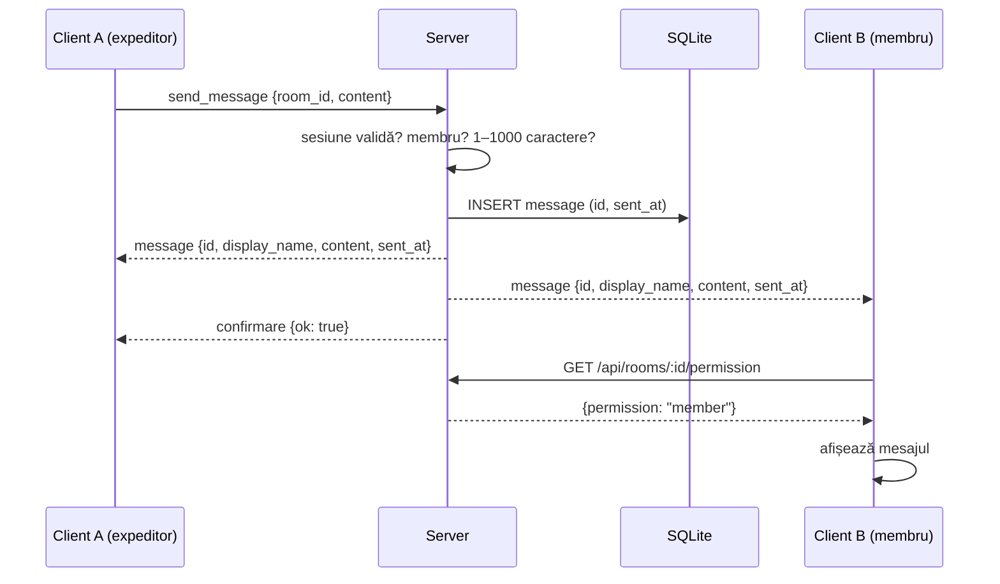
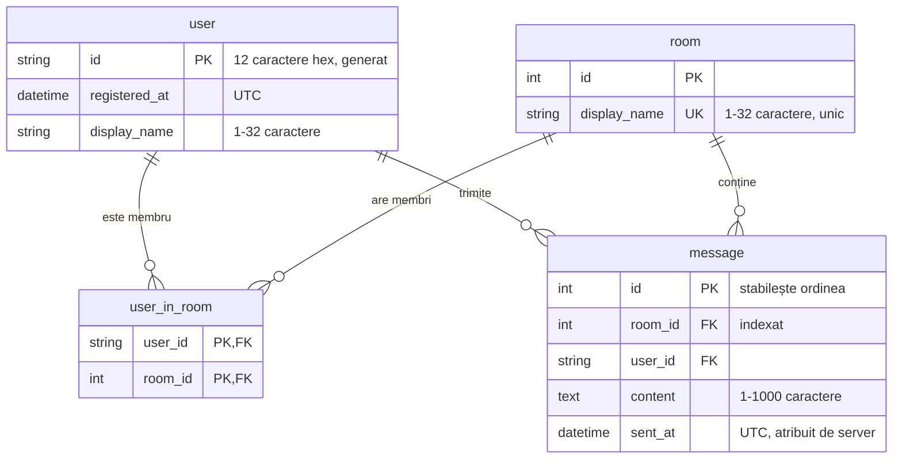

# MiniChat — mesagerie locală cu istoric

**Subiectul 44** · MiniChat - camere tematice · Python 3.14 · Flask + Socket.IO + SQLite

Aplicație de chat pe camere, cu server Python local și client web. Serverul și două-trei ferestre-client rulează pe același laptop, fără internet. Mesajele se păstrează în SQLite și se recuperează după o deconectare.

---

## 1. Prezentare generală și obiective

### Titlul proiectului și echipa

| Membru | Grupa | GitHub |
|---|---|---|
| _Nume Prenume (de completat)_ | _de completat_ | [kommanderm](https://github.com/kommanderm) |
| _Nume Prenume (de completat)_ | _de completat_ | _de completat_ |

Varianta aleasă: **44A / 44B** _(de completat)_

### Context și scop (problem statement)

Un grup mic (de exemplu, o echipă la laborator) are nevoie de o mesagerie care funcționează complet local: fără conturi în cloud, fără internet, cu istoric care nu se pierde dacă un client sau serverul se oprește. Utilizatorii țintă sunt **utilizatori demonstrativi** cu identități fictive. Aceștia schimbă mesaje în camere tematice printr-un server Python care rulează pe același calculator sau în aceeași rețea locală.

### Obiective principale (SMART)

1. **Server local cu validare.** Fiecare mesaj este acceptat doar dacă expeditorul are o sesiune validă și este membru al camerei. Serverul atribuie fiecărui mesaj un ID și un marcaj temporal UTC și respinge textul gol sau mai lung de 1000 de caractere.
2. **Istoric persistent.** Toate mesajele se salvează în SQLite. La deschiderea unei camere și după fiecare reconectare se reîncarcă ultimele 100 de mesaje, fără dubluri.
3. **Mesaje în timp real, fără blocarea interfeței.** Socket.IO livrează mesajele (WebSocket, cu interogare periodică ca rezervă) pentru minimum 3 clienți simultani.
4. **Calitate verificată automat.** O suită de 116 teste automate acoperă toate rutele HTTP și toate evenimentele Socket.IO. Suita rulează la fiecare pornire a serverului.

### Limitele proiectului (scope limitations)

- **Fără parole și fără OAuth.** Autentificarea folosește un ID generat la înregistrare, adică o identitate fictivă cu ID stabil. ID-ul este singura credențială.
- **Fără HTTPS.** Aplicația este destinată exclusiv rulării pe același laptop sau în aceeași rețea locală.
- **Fără cloud.** Stocarea este un fișier SQLite local (`db.sqlite`), fără replicare.
- **Fără administrare.** Nu există roluri de administrator sau moderator și nu se pot șterge sau edita mesaje.
- **Fără atașamente.** Nu se trimit fișiere sau imagini și nu există notificări pentru camerele care nu sunt deschise.
- **Server de dezvoltare.** Aplicația folosește serverul de dezvoltare Werkzeug, potrivit pentru demonstrație, nu pentru producție.

---

## 2. Cerințe funcționale

### Funcționalități

**Must-have (implementate)**

1. Înregistrare cu nume afișat (1–32 caractere). Serverul generează un ID de autentificare de 12 caractere hexazecimale.
2. Autentificare cu ID-ul primit și deconectare. Sesiunea Flask este semnată și durează 7 zile.
3. Camere: creare (nume unic), intrare ca membru (_Join_) și părăsire (_Leave_).
4. Clasificarea camerelor în interfață după permisiune: _Your rooms_ (`member`) și _Other rooms_ (`none`).
5. Trimiterea și primirea mesajelor în timp real, în camera selectată.
6. Istoric salvat în SQLite. La deschiderea camerei se încarcă ultimele 100 de mesaje.
7. Reconectare automată. După revenirea serverului, clientul reintră în cameră și reîncarcă istoricul.
8. Verificarea permisiunii la fiecare mesaj primit: clientul apelează `GET /api/rooms/<id>/permission` înainte de afișare.

**Nice-to-have (în afara versiunii curente)**

- Notificări sau contor de mesaje necitite pentru celelalte camere.
- Paginarea istoricului mai vechi de 100 de mesaje.
- Editarea sau ștergerea propriilor mesaje.

### Corespondența cu cerințele subiectului 44

| Cerință | Stare | Cum este rezolvată |
|---|---|---|
| Server local și interfață-client | ✅ | Server Flask-SocketIO pe portul 5000, client web în browser |
| Identitate fictivă cu ID stabil | ✅ | ID de 12 caractere hex, generat la înregistrare și folosit la autentificare |
| Serverul verifică expeditorul și apartenența la conversație | ✅ | Expeditorul este luat din sesiunea semnată, nu din datele trimise de client. Apartenența se verifică în `user_in_room` la fiecare mesaj |
| ID și marcaj temporal atribuite de server | ✅ | `message.id` (autoincrement) și `message.sent_at` (UTC) |
| Respingerea textului gol sau prea lung | ✅ | 1–1000 de caractere după curățare (vezi [Validarea datelor primite](#interfața-serverului)); altfel răspuns `{"ok": false, "error": ...}` |
| Trimitere și primire fără blocarea interfeței | ✅ | Socket.IO asincron; o coadă de promisiuni păstrează ordinea de sosire |
| Ordinea stabilită de server | ✅ | Istoricul este ordonat după `message.id`, nu după ceasul clientului |
| Mesaje salvate în SQLite | ✅ | Tabelul `message` |
| Reluarea citirii după ultimul ID primit | 🟡 Parțial | La reconectare se reîncarcă ultimele 100 de mesaje și se elimină dublurile după ID. Nu există încă un parametru „după ID-ul X” |
| Trimitere repetată cu același identificator de operație fără duplicat | ⏳ Planificat | Nu este implementată încă |
| Recuperarea istoricului lipsă după reconectare | 🟡 Parțial | Funcționează pentru ultimele 100 de mesaje ale camerei |
| Afișarea conversației, autorului, timpului și formularului | ✅ | Pagina de chat |
| Starea conexiunii și mesaje clare la oprirea serverului | 🟡 Parțial | Mesajul „Connection lost, retrying…” la pierderea conexiunii. Lipsește un indicator permanent de stare |
| Un mesaj neconfirmat nu apare ca trimis | ✅ | Mesajul apare doar după ce serverul îl salvează și îl difuzează. Câmpul de text se golește doar după confirmare |
| Adnotări de tip | ⏳ Planificat | |
| Teste automate: flux normal, caz-limită, caz de eroare | ✅ | 116 teste, vezi [Strategia de testare](#strategia-de-testare) |
| Regula variantei alese (44A/44B) | ⏳ | _de completat după alegerea variantei_ |

### Scenarii de utilizare (fluxuri)

1. **Înregistrare.** Utilizatorul introduce un nume afișat → serverul validează numele și generează ID-ul → ID-ul se afișează o singură dată (_„Save it: it is the only way to log back in”_) → sesiunea pornește automat.
2. **Autentificare.** Utilizatorul introduce ID-ul → serverul caută utilizatorul → sesiunea este creată → se deschide pagina de chat.
3. **Alegerea camerei.** Utilizatorul creează o cameră sau apasă _Join_ în _Other rooms_ → camera trece în _Your rooms_ → la click, clientul emite `enter_room` și primește istoricul.
4. **Trimiterea unui mesaj.**



5. **Deconectare și reluare.** Serverul se oprește → clientul afișează _„Connection lost, retrying…”_ și reîncearcă automat → la revenire, clientul reintră în camera deschisă și reîncarcă istoricul, fără să dubleze mesajele deja afișate.

### Interfața cu utilizatorul

**Aplicație web minimală cu Flask**, fără framework de frontend: HTML (șabloane Jinja), CSS și JavaScript simplu. Clientul Socket.IO 4.8.1 este inclus local în `app/static/js/`, deci nu este nevoie de internet. Interfața are două pagini:

- **Autentificare:** formularele _Register_ și _Log in_.
- **Chat:** bara de sus (nume, ID, _Log out_), lista de camere clasificată după permisiune, conversația selectată (ora, autorul, textul) și formularul de trimitere.

Interfața se adaptează automat la tema luminoasă sau întunecată a sistemului și la ecrane înguste (telefon).

---

## 3. Arhitectură, tehnologii și structura datelor

### Stiva tehnologică

| Componentă | Versiune | Rol |
|---|---|---|
| Python | 3.14 | limbajul aplicației |
| Flask | 3.1 | server web, rute, sesiuni, șabloane |
| Flask-SocketIO | 5.7 (python-socketio 5.17, simple-websocket 1.1) | mesaje în timp real |
| Flask-SQLAlchemy / SQLAlchemy | 3.1 / 2.1 | ORM peste SQLite |
| SQLite | inclus în Python | baza de date locală |
| Socket.IO (client JS) | 4.8.1 | conexiunea din browser |
| unittest | inclus în Python | teste automate (fără dependențe în plus) |
| uv | ≥ 0.12 | gestionarea mediului și a dependențelor (recomandat) |
| venv + pip | incluse în Python | alternativă la uv, folosind `requirements.txt` |

### Modelul de date



Permisiunea unui utilizator într-o cameră este derivată din `user_in_room`: `member` dacă există rândul respectiv, altfel `none`.

### Interfața serverului

**API HTTP (JSON).** Erorile au forma `{"error": "..."}`, cu codurile 400, 401, 403, 404, 409 și 413.

| Metodă | Rută | Descriere |
|---|---|---|
| GET | `/` | pagina de autentificare sau de chat, după sesiune |
| POST | `/api/register` | `{display_name}` → creează utilizatorul și pornește sesiunea |
| POST | `/api/login` | `{id}` → autentificare cu ID-ul primit la înregistrare |
| POST | `/api/logout` | închide sesiunea |
| GET | `/api/me` | utilizatorul curent |
| GET | `/api/rooms` | toate camerele, fiecare cu permisiunea utilizatorului |
| POST | `/api/rooms` | `{display_name}` → creează camera; creatorul devine membru |
| POST | `/api/rooms/<id>/join` | devine membru al camerei |
| POST | `/api/rooms/<id>/leave` | părăsește camera |
| GET | `/api/rooms/<id>/permission` | `{room_id, permission}`, verificat de client la fiecare mesaj primit |
| GET | `/api/rooms/<id>/messages` | ultimele 100 de mesaje, de la cel mai vechi (doar pentru membri) |

**Evenimente Socket.IO.** Conexiunea este refuzată fără o sesiune validă.

| Direcție | Eveniment | Date | Răspuns |
|---|---|---|---|
| client → server | `enter_room` | `{room_id}` | `{ok}`. Abonează conexiunea la cameră și o dezabonează de la cea anterioară |
| client → server | `exit_room` | — | `{ok}` |
| client → server | `send_message` | `{room_id, content}` | `{ok}` sau `{ok: false, error}` |
| server → client | `message` | `{id, room_id, display_name, content, sent_at}` | — |
| server → client | `rooms_changed` | — | clientul reîncarcă lista de camere |

**Securitate.** ID-ul de autentificare nu este trimis niciodată altor utilizatori, iar mesajele conțin doar numele afișat. Tot textul primit este afișat ca text simplu (`textContent`), deci HTML-ul din mesaje nu se execută.

**Validarea datelor primite.** Tot ce trimite clientul, prin API-ul HTTP sau prin Socket.IO, trece prin `app/validation.py`:

- textul este normalizat Unicode (NFC), iar caracterele de control, caracterele invizibile (de exemplu spațiul de lățime zero sau cele care inversează direcția textului) și surogatele izolate sunt eliminate;
- numele de utilizatori și de camere au spațiile comprimate; mesajele își păstrează rândurile noi, cu cel mult un rând gol consecutiv;
- lungimea (1–32 de caractere pentru nume, 1–1000 pentru mesaje) se verifică după curățare;
- ID-ul de autentificare trebuie să aibă exact 12 caractere hexazecimale, iar ID-ul unei camere trebuie să fie un întreg pozitiv care încape în SQLite;
- două camere nu pot avea același nume, indiferent de majuscule;
- corpurile de cerere HTTP mai mari de 16 KB primesc 413, iar pachetele Socket.IO sunt limitate la 64 KB;
- orice eroare apărută într-un eveniment Socket.IO primește tot un răspuns `{ok: false, error}`, deci clientul nu rămâne blocat.

HTML-ul nu este eliminat din text: se păstrează așa cum a fost scris și este afișat ca text simplu.

### Arhitectura codului

Logica de stocare, rutele HTTP, evenimentele în timp real și interfața sunt separate în module distincte:

```
minichat/
├── deploy.py              # instalare și pornire, cu uv sau cu venv + pip
├── run.py                 # punct de intrare: rulează testele, apoi pornește serverul
├── pyproject.toml         # dependențele proiectului (uv.lock: versiunile exacte)
├── requirements.txt       # aceleași versiuni exacte, pentru pip (generat din uv.lock)
├── app/
│   ├── __init__.py        # aplicația Flask: configurare, blueprint-uri, crearea tabelelor
│   ├── config.py          # configurația demonstrativă
│   ├── validation.py      # curățarea și validarea datelor primite de la client
│   ├── db/db.py           # stocare: modelele User, Room, Message, user_in_room, Permission
│   ├── routes/__init__.py # pagina principală (autentificare sau chat)
│   ├── routes/api.py      # API-ul HTTP JSON
│   ├── socket/socket.py   # evenimentele Socket.IO: intrare/ieșire din cameră, trimitere
│   ├── templates/         # base.html, login.html, chat.html
│   └── static/
│       ├── css/style.css
│       └── js/            # api.js (fetch), login.js, chat.js, socket.io.min.js
└── tests/
    ├── __init__.py        # baza comună: SQLite în memorie, clienți de test
    ├── __main__.py        # runner cu rezultate formatate (python -m tests)
    ├── test_pages.py      # pagina principală și fișierele statice
    ├── test_auth.py       # înregistrare, autentificare, deconectare, sesiune
    ├── test_rooms.py      # camere, permisiuni, istoric
    ├── test_socket.py     # conexiune și evenimente Socket.IO
    └── test_validation.py # curățarea și validarea datelor
```

Adresa serverului nu este scrisă în cod: clientul o construiește din `document.domain` și `location.port`, deci funcționează la orice adresă de pe care a fost deschisă pagina.

---

## 4. Planificare, testare și livrabile

### Etape de implementare (roadmap)

| Fază | Conținut | Stare |
|---|---|---|
| 1. Design și baza de date | structura tabelelor, modelele SQLAlchemy | ✅ |
| 2. Logica backend | API HTTP, sesiuni, evenimente Socket.IO, validări | ✅ |
| 3. Interfață și integrare | paginile de autentificare și chat, reconectare | ✅ |
| 4. Testare și documentare | 116 teste automate, runner formatat, README | ✅ |
| 5. Conformitate completă cu subiectul | identificator de operație contra duplicatelor, reluare după ultimul ID, indicator de stare a conexiunii, adnotări de tip, regula variantei, date demonstrative | ⏳ |

### Strategia de testare

Testele folosesc `unittest` din biblioteca standard. Fiecare test pornește de la o bază SQLite **în memorie**, goală, deci baza reală `db.sqlite` nu este atinsă niciodată. Clienții de test Flask și Socket.IO simulează mai mulți utilizatori simultan.

| Fișier | Teste | Acoperă |
|---|---|---|
| `test_pages.py` | 8 | pagina de autentificare și de chat, escaparea HTML, fișierele statice |
| `test_auth.py` | 23 | înregistrare, autentificare, deconectare, `/api/me`, durata sesiunii, nume curățate, ID-uri invalide |
| `test_rooms.py` | 36 | creare, listare, join/leave, permisiuni, istoric (ordine, limită, izolare), ID-uri de cameră invalide |
| `test_socket.py` | 31 | conexiune, `enter_room`, `exit_room`, `send_message`, difuzare, date invalide, erori neprevăzute |
| `test_validation.py` | 18 | curățarea textului, nume, mesaje, ID-uri de autentificare și de cameră |

Exemple pentru categoriile cerute de subiect:

- **Flux normal:** `test_broadcasts_to_everyone_in_the_room_including_sender`. Un mesaj ajunge la toți cei din cameră și este identic cu cel din istoric.
- **Caz-limită:** `test_accepts_max_length` (exact 1000 de caractere) și `test_limited_to_latest_messages` (doar ultimele 100 de mesaje).
- **Caz de eroare:** `test_rejects_too_long`, `test_rejects_invalid_content` și `test_non_member_cannot_send`. Niciunul dintre aceste mesaje nu este salvat.

Rulare:

```bash
python3 deploy.py --no-start   # instalează dependențele și rulează doar testele
uv run python -m tests         # doar testele, cu rezultate formatate
uv run run.py                  # testele rulează automat înainte de pornirea serverului
```

Dacă un test eșuează, serverul nu pornește și se afișează eroarea completă. Pentru a porni totuși serverul: `uv run run.py --skip-tests`.

### Livrabile finale

- Depozitul Git cu codul sursă: <https://github.com/kommanderm/Proiect_Python_Poli>
- Configurația demonstrativă: `app/config.py`. Baza de date se creează automat la prima rulare.
- Testele automate din `tests/`.
- Scriptul de deploy `deploy.py` și lista dependențelor: `requirements.txt` pentru pip, `uv.lock` pentru uv.
- Acest fișier README cu instalarea, dependențele, rularea și sursele.
- O scurtă prezentare _(de completat)_.

---

## Instalare, deploy și rulare

### Cerințe

Există două variante de instalare:

- **cu [uv](https://docs.astral.sh/uv/)** (recomandat): este nevoie doar de uv, care descarcă singur Python 3.14 dacă lipsește;
- **cu venv + pip**: este nevoie de Python **3.14** sau mai nou, instalat pe sistem.

Ambele variante instalează exact aceleași versiuni ale pachetelor.

### Deploy cu un singur pas (recomandat)

```bash
git clone https://github.com/kommanderm/Proiect_Python_Poli.git
cd Proiect_Python_Poli
python3 deploy.py        # Windows: py deploy.py
```

`deploy.py` folosește doar biblioteca standard, deci poate fi rulat cu orice Python 3.8+. Scriptul alege singur varianta de instalare: uv dacă este găsit în `PATH`, altfel venv + pip. Pașii sunt:

| Pas | Cu uv | Cu venv + pip |
|---|---|---|
| 1. Mediul Python | `uv sync --locked` creează `.venv` cu Python 3.14 (îl descarcă dacă lipsește) | caută un Python ≥ 3.14 (`python3.14`, `python3`, `python`, pe Windows `py -3`) și creează `.venv` dacă nu există |
| 2. Dependențele | instalate din `uv.lock` | `pip install -r requirements.txt` în `.venv` |
| 3. Testele | rulate de `run.py` înainte de pornire | la fel |
| 4. Serverul | pornește pe portul 5000 (`Ctrl+C` îl oprește) | la fel |

Scriptul poate fi rulat de câte ori este nevoie. Refolosește `.venv`, instalează doar ce lipsește, iar baza de date `db.sqlite` rămâne neatinsă.

Opțiuni:

| Opțiune | Efect |
|---|---|
| `--mode auto` | implicit: uv dacă este instalat, altfel venv + pip |
| `--mode uv` | forțează uv (eroare clară dacă uv nu este instalat) |
| `--mode pip` | forțează venv + pip, chiar dacă uv este instalat |
| `--no-start` | instalează și rulează testele, fără să pornească serverul (util pentru verificare) |
| `--skip-tests` | pornește serverul fără să ruleze testele |

Exemple:

```bash
python3 deploy.py --mode pip               # instalare clasică, fără uv
python3 deploy.py --no-start               # verificare: instalare + teste
python3 deploy.py --mode uv --skip-tests   # pornire rapidă cu uv
```

### Fișierul `requirements.txt`

`requirements.txt` listează toate cele 17 pachete instalabile, inclusiv dependențele indirecte, cu versiuni fixe (`==`). Este generat din `uv.lock`, deci uv și pip instalează exact aceleași versiuni. După orice schimbare a dependențelor (de exemplu `uv add <pachet>`), fișierul se regenerează cu:

```bash
uv export --locked --format requirements.txt --no-hashes --no-emit-project -o requirements.txt
```

### Instalare manuală (fără script)

Cu uv:

```bash
uv sync --locked   # creează .venv și instalează dependențele din uv.lock
uv run run.py      # rulează testele, apoi pornește serverul pe portul 5000
```

Cu venv + pip (Linux/macOS):

```bash
python3.14 -m venv .venv
.venv/bin/python -m pip install -r requirements.txt
.venv/bin/python run.py
```

Cu venv + pip (Windows, PowerShell):

```powershell
py -3.14 -m venv .venv
.venv\Scripts\python.exe -m pip install -r requirements.txt
.venv\Scripts\python.exe run.py
```

### Probleme frecvente

| Mesaj | Cauză și soluție |
|---|---|
| `ensurepip is not available` | Pe Debian/Ubuntu, Python vine fără `ensurepip`. `deploy.py` ocolește problema singur: creează `.venv` fără pip și instalează pachetele cu pip-ul sistemului. Dacă nici acesta nu există: `sudo apt install python3.14-venv` |
| `Python 3.14+ was not found` | Instalați Python 3.14 sau instalați uv, care îl descarcă singur |
| `.venv uses Python 3.x` | `.venv` a fost creat cu un Python prea vechi: ștergeți folderul `.venv` și rulați din nou `deploy.py` |
| `Address already in use` | Portul 5000 este ocupat, de obicei de un server MiniChat pornit deja: opriți-l |
| `The Werkzeug web server is not designed to run in production` | Serverul trebuie pornit dintr-un terminal interactiv, nu în fundal |
| Celelalte dispozitive din rețea nu se pot conecta | Permiteți portul 5000 în firewall (de exemplu `sudo ufw allow 5000/tcp`) |

### Configurare

Valorile din `app/config.py` pot fi suprascrise prin variabile de mediu cu prefixul `FLASK_`:

| Setare | Implicit | Exemplu de suprascriere |
|---|---|---|
| `SQLALCHEMY_DATABASE_URI` | `sqlite:///../db.sqlite` (în rădăcina proiectului) | `FLASK_SQLALCHEMY_DATABASE_URI=sqlite:////tmp/demo.sqlite` |
| `SECRET_KEY` | `change_in_prod` | `FLASK_SECRET_KEY=o-cheie-lunga-si-aleatoare` |
| `PERMANENT_SESSION_LIFETIME` | 7 zile | — |

### Atenție: o sesiune pe browser

> [!WARNING]
> Autentificarea se face prin **sesiunea Flask**, păstrată într-un cookie în browser timp de **7 zile**. Toate filele și ferestrele aceluiași browser (același profil) folosesc **același cookie**, deci **același utilizator**. Pentru ca mai mulți utilizatori să comunice local prin server, fiecare are nevoie de **un browser diferit** sau de **o fereastră incognito/privată**.

Ce înseamnă asta în practică:

- **O filă nouă nu înseamnă un utilizator nou.** A doua filă deschisă în același browser este deja autentificată ca același utilizator.
- **Autentificarea ca alt utilizator îl înlocuiește pe cel vechi în tot browserul.** O filă deschisă mai devreme afișează în continuare vechiul nume și trimite mesaje ca vechiul utilizator, până la reîncărcare. În același timp, cererile ei HTTP (lista de camere, istoricul, verificarea permisiunii) folosesc deja noul utilizator. O astfel de filă amestecă două identități: reîncărcați-o (`F5`).
- **Închiderea filei nu deconectează utilizatorul.** Sesiunea rămâne activă 7 zile. Doar _Log out_ o încheie, și atunci o încheie în toate filele acelui browser.
- **Ferestrele incognito ale aceluiași browser împart o singură sesiune**, separată de cea a ferestrelor normale. Un browser oferă deci cel mult doi utilizatori: unul în ferestrele normale și unul în cele incognito. Închiderea tuturor ferestrelor incognito șterge sesiunea lor, așa că păstrați ID-ul pentru a vă autentifica din nou.

Cum obțineți utilizatori separați pe același laptop:

| Metodă | Exemplu | Sesiuni separate |
|---|---|---|
| Browsere diferite | Firefox, Chrome, Edge | câte una pentru fiecare browser |
| Fereastră incognito / privată | `Ctrl+Shift+N` (Chrome, Edge), `Ctrl+Shift+P` (Firefox) | încă una pentru fiecare browser |
| Profiluri de browser diferite | un al doilea profil în Chrome sau Firefox | câte una pentru fiecare profil |
| Altă adresă pentru același server | <http://127.0.0.1:5000>, <http://localhost:5000>, `http://<IP-ul laptopului>:5000` | câte una pentru fiecare adresă, pentru că browserul păstrează cookie-urile separat pentru fiecare adresă |

Telefoanele și celelalte dispozitive din rețea au fiecare propria sesiune, deci nu sunt afectate.

### Demonstrație: server și 2–3 clienți pe același laptop

Ferestrele aceluiași browser împart aceeași sesiune (vezi [Atenție: o sesiune pe browser](#atenție-o-sesiune-pe-browser)). Pentru utilizatori diferiți pe același laptop, deschideți:

1. **Clientul 1:** <http://127.0.0.1:5000>
2. **Clientul 2:** <http://localhost:5000> (alt nume de gazdă, deci altă sesiune)
3. **Clientul 3:** o fereastră privată sau incognito cu <http://127.0.0.1:5000>

Pași:

1. În fiecare fereastră, apăsați _Register_ cu alt nume și notați ID-ul afișat.
2. În clientul 1, creați camera `general`. În celelalte ferestre camera apare în _Other rooms_: apăsați _Join_.
3. Trimiteți mesaje și observați că apar în toate ferestrele, cu autorul și ora.
4. Opriți serverul (`Ctrl+C`): clienții afișează _„Connection lost, retrying…”_.
5. Reporniți serverul (`python3 deploy.py` sau `uv run run.py`): clienții se reconectează singuri, iar istoricul este păstrat.
6. Apăsați _Log out_, apoi _Log in_ cu ID-ul notat. Utilizatorul și camerele lui sunt aceleași.

Opțional, din alte dispozitive din aceeași rețea, deschideți `http://<IP-ul laptopului>:5000`. Serverul afișează adresa la pornire.

---

## Surse

- Flask: <https://flask.palletsprojects.com/>
- Flask-SocketIO: <https://flask-socketio.readthedocs.io/>
- Flask-SQLAlchemy: <https://flask-sqlalchemy.readthedocs.io/>
- SQLAlchemy 2.x: <https://docs.sqlalchemy.org/>
- Socket.IO (protocol și client JavaScript, licență MIT, inclus în `app/static/js/socket.io.min.js`): <https://socket.io/docs/v4/>
- SQLite: <https://www.sqlite.org/docs.html>
- Python `unittest`: <https://docs.python.org/3/library/unittest.html>
- uv: <https://docs.astral.sh/uv/>
